<div align="center">



<a href="https://github.com/vaibhav668">
  
</a>

<br/>

[](https://www.linkedin.com/in/vaibhav-pokhriyal-a8b08023a/)
[](mailto:vpokhriyal35@gmail.com)
[](https://github.com/vaibhav668?tab=repositories)


</div>


## <samp>CH.00 / WHOAMI</samp>

```python
class Vaibhav:
    name       = "Vaibhav Pokhriyal"
    education  = "B.Tech CSE (AI & ML), GBPIET Pauri Garhwal | 2024 - 2028"
    semester   = 5

    experience = {
        "Mind Masters AI Solutions":      "AI Engineer Intern  | Jun - Sep 2026 | Voice AI, agentic systems",
        "IIT Delhi, Neuro Computing Lab": "Research Intern     | Feb - May 2026 | GNNs for EEG seizure detection",
    }

    building   = "Wearable EOG/EMG nurse-call system for patients who are conscious but cannot speak"
    writing    = "Paper: Hybrid Spatiotemporal GNN for EEG-based seizure detection"
    sharpening = ["DSA (300 quality problems)", "DBMS", "OS", "Computer Networks", "SQL / PostgreSQL"]

    open_to    = ["Research collaborations", "Summer 2027 internships"]
```


## <samp>CH.01 / EXPERIENCE</samp>

<table>
<tr>
<td width="50%" valign="top">

<samp>JUN 2026 - SEP 2026 &nbsp;|&nbsp; REMOTE &nbsp;|&nbsp; COMPLETED</samp>

### AI Engineer Intern
**Mind Masters AI Solutions Pvt. Ltd.**

- Built a multilingual voice customer-support agent end to end: telephony, STT / TTS / VAD, knowledge base, booking lookups and authorized tool calling
- Designed agent workflows in LangGraph with MCP tool integration and conversation state management
- FastAPI + PostgreSQL + WebSockets backend for live transcripts, call states, resolution tracking and DTMF feedback, synced with the CRM
- Built an outbound AI cold-calling agent; benchmarked leading STT and TTS models to choose the stack and shipped a demo on the company website
- Built support and enquiry chatbots and integrated voice + chat into the company site and booking platform (auth, CRM, existing backend)

</td>
<td width="50%" valign="top">

<samp>FEB 2026 - MAY 2026 &nbsp;|&nbsp; HYBRID &nbsp;|&nbsp; COMPLETED</samp>

### Research Intern
**Neuro Computing Lab, IIT Delhi** under Prof. Tapan Kumar Gandhi

- Hybrid GAT + BiLSTM framework for epileptic seizure detection on CHB-MIT, in PyTorch and PyTorch Geometric
- EEG pipeline: preprocessing, Pearson-correlation graph construction, feature engineering, temporal sequence modeling
- Focal loss and patient-wise evaluation to handle roughly 1:40 seizure-to-normal imbalance
- Compared against CNN scalogram classification with AlexNet

<samp>ACC 0.84 &nbsp;|&nbsp; MACRO-F1 0.82 &nbsp;|&nbsp; SEIZURE RECALL 0.78 &nbsp;|&nbsp; ROC-AUC 0.914</samp>

Paper in preparation: *Hybrid Spatiotemporal Graph Neural Network Framework for EEG-Based Epileptic Seizure Detection*

</td>
</tr>
</table>


## <samp>CH.02 / BUILDS</samp>

<table>
<tr>
<td>

<samp>STATUS: IN DEVELOPMENT &nbsp;|&nbsp; HACKATHON BUILD</samp>

### Assistive Biosignal Band
A wearable nurse-call system for ICU and paralyzed patients who are conscious but cannot speak.

- Light bands on both wrists (EMG) and one on the forehead (EOG), built on NPG Lite and streaming wirelessly
- Custom command patterns per patient, for example 3 blinks + 2 squeezes calls the nurse, with others for pain, water and more
- Central ward dashboard where on-duty staff see live requests for every patient, with many staff sessions running at once
- Next phase: a multi-channel wrist EMG dataset, labelled per finger, for finger-level gesture classification

`NPG Lite` `EOG` `EMG` `Python` `FastAPI` `WebSockets` `PostgreSQL`

</td>
</tr>
</table>

| Project | What it does | Stack | Code |
|---|---|---|---|
| **EEG Seizure Detection** | Graph-based spatiotemporal model for seizure detection on CHB-MIT | PyTorch Geometric, GAT, BiLSTM, MNE | [](https://github.com/vaibhav668/Hybrid-Spatiotemporal-Graph-Neural-Network-Framework-for-EEG-Based-Epileptic-Seizure-Detection) |
| **IntelliGuard AI** | Real-time accident, fight and fire/smoke detection with live alerts, tracking and speed estimation | YOLOv8, ResNet18, OpenCV, FastAPI, Streamlit, Docker | [](https://github.com/vaibhav668/INTELLIGUARD-AI) |
| **YouTube AI Assistant** | Chrome extension that answers questions about any video using its transcript (RAG) | LangChain, FAISS, Qwen2.5-7B, MiniLM, FastAPI | [](https://github.com/vaibhav668/YT_AI_ASSISTANT_EXTENSION) |
| **BERT Resume Role Classifier** | Classifies resume PDFs into ~25 job roles with per-role error analysis | BERT, PyTorch, Hugging Face, scikit-learn | [](https://github.com/vaibhav668/bert-resume-role-classifier) |
| **Hands-free Subway Surfers** | Play the game with body movement through pose landmarks and debounced key mapping | MediaPipe Pose, OpenCV, pynput | [](https://github.com/vaibhav668/Subway-Surfer-Handless-Version) |
| **Air Sketch** | Draw in the air with a pinch gesture, no mouse or keyboard | MediaPipe Hands, OpenCV, NumPy | [](https://github.com/vaibhav668/SketchWithOpencvCv) |


## <samp>CH.03 / CURRENT FOCUS</samp>




## <samp>CH.04 / TOOLKIT</samp>

**Languages**<br/>


**ML / DL**<br/>


**Agentic AI and Voice**<br/>


**Computer Vision and Signals**<br/>


**Backend and Deployment**<br/>


**Embedded and Robotics**<br/>


## <samp>CH.05 / ACHIEVEMENTS AND LEADERSHIP</samp>

| | |
|---|---|
| **2nd Runner-Up, Nano Navigator** <br/><samp>COGNIZANCE 2026, IIT ROORKEE</samp> | Autonomous micromouse: ESP32, flood-fill maze solving, VL53L0X time-of-flight sensors, TB6612FNG motor driver |
| **2nd Place, BlindBot Battle** <br/><samp>TRYST 2025, IIT DELHI</samp> | Autonomous soccer robot with sensor-based navigation |
| **Web Master** <br/><samp>IEEE STUDENT BRANCH, GBPIET</samp> | Manage the branch website and technical content |
| **Google Gemini Student Ambassador** | AI education workshops and community outreach |
| **Technical Mentor** <br/><samp>PRASTHANAM ROBOTICS CLUB, GBPIET</samp> | Workshops on computer vision, hardware control, home automation, Git, Tinkercad and drones; mentored junior teams for Cognizance |


## <samp>CH.06 / TELEMETRY</samp>

<div align="center">


<picture>
  <source media="(prefers-color-scheme: dark)" srcset="https://raw.githubusercontent.com/vaibhav668/vaibhav668/output/github-snake-dark.svg">
  <source media="(prefers-color-scheme: light)" srcset="https://raw.githubusercontent.com/vaibhav668/vaibhav668/output/github-snake.svg">
  
</picture>

</div>


## <samp>CH.07 / COMMS</samp>

<div align="center">

Not taking an internship this semester. Open to research collaborations and summer 2027 internships in AI/ML, voice and agentic systems, and healthcare signal processing.

[](https://www.linkedin.com/in/vaibhav-pokhriyal-a8b08023a/)
[](mailto:vpokhriyal35@gmail.com)

<br/>



</div>
